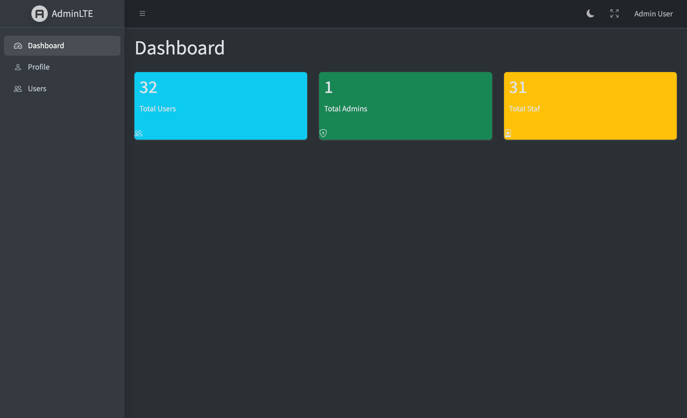

# PBKK-210

Tugas Mandiri PBKK — Dashboard & RBAC Implementation.

Laravel 13 admin panel for a mock academic portal, built on top of Laravel Breeze for authentication, AdminLTE 4 for the visual shell, and `spatie/laravel-permission` for dynamic, database-backed role-based access control.

## Stack

- **PHP** ^8.3
- **Laravel** ^13.17
- **Laravel Breeze** ^2.4 (Blade stack) — authentication scaffolding
- **AdminLTE** ^4.10 via `jeroennoten/laravel-adminlte` ^4.0 — admin panel layout
- **Spatie Laravel Permission** ^8.5 — roles and permissions stored in the database
- **SQLite** — default database (file at `database/database.sqlite`)
- **Faker** — dummy data seeding

## Features

- **AdminLTE dashboard shell** with sidebar navigation, dark-mode toggle, and fullscreen widget
- **Laravel Breeze authentication** — login, registration, password reset, email verification, password confirmation
- **Spatie RBAC** — `Admin` (full access) and `Staf` (limited) roles persisted to `roles`, `permissions`, `model_has_roles`, `role_has_permissions` tables
- **Dashboard widgets** — three aggregated `count()` statistics (total users, total admins, total staf) rendered as AdminLTE `small-box` widgets
- **User index** — paginated table (10 rows/page) with `when()`-based search across `name` and `email`, and `withQueryString()` to preserve the search keyword across pagination
- **Permission-gated deletion** — `UserController::destroy` is protected by constructor middleware `permission:delete-data`; the "Hapus" button is wrapped in `@can('delete-data')` so it renders only for admin users
- **Faker seeders** — `RoleSeeder` + `UserSeeder` + `DummyUserSeeder` creates 32 users on `migrate --seed`
- **One-click demo login** — quick-login buttons on `/login` for evaluator convenience (see "Demo quick login" below)

## Installation

```bash
# 1. Clone
git clone https://github.com/ilhmpbta/pbkk-210
cd pbkk-210

# 2. PHP dependencies
composer install

# 3. Environment
cp .env.example .env
php artisan key:generate

# 4. Create SQLite database (if not present)
touch database/database.sqlite

# 5. Migrate and seed
php artisan migrate:fresh --seed

# 6. Frontend assets
npm install
npm run build

# 7. Serve
php artisan serve
```

Open <http://localhost:8000>.

The seeding step is important — the demo accounts and the permission set are created by the seeders. `php artisan migrate` alone will leave you without roles, permissions, or test users, and the demo-login buttons on `/login` will return 404.

## Demo accounts

| Role | Email | Password | Can delete? |
|------|-------|----------|-------------|
| Admin | `admin@example.com` | `password` | Yes |
| Staf | `staf@example.com` | `password` | No |

Both accounts are seeded with `email_verified_at = now()` so they pass the `verified` middleware on `/dashboard`.

## Demo quick login

The login page (`/login`) includes two one-click login buttons:

- **Login as Admin** → authenticates as `admin@example.com`
- **Login as Staf** → authenticates as `staf@example.com`

These POST to a `demo-login/{role}` route in `routes/web.php` which calls `Auth::login()` on the seeded user. **This is a demo convenience, not a production feature** — it bypasses password verification entirely. If you deploy this beyond a classroom evaluation, remove the `demo-login` route and the two buttons from `resources/views/auth/login.blade.php`.

## Using the app

1. Visit `/login`. Use either a demo quick-login button or the seeded credentials above.
2. **Dashboard** — three widgets show total users, total admins, and total staf (dynamically via `count()` aggregates in `DashboardController`).
3. **Users** — paginated list of all users with a search box. Type a name or email fragment and click Search; the filter is preserved across pagination pages via `withQueryString()`.
4. **Hapus (delete) button** — visible only to users with the `delete-data` permission (Admin only). Staf users do not see the button, and the `DELETE /users/{id}` route returns 403 for them because the `permission:delete-data` middleware is applied at the controller constructor level.
5. **Profile** — update name / email / password, or delete your own account (Breeze default).
6. **Logout** — top-right user menu.

## Demonstration script

To demonstrate the RBAC guard in class:

1. Click **Login as Admin** on `/login`.
2. Navigate to **Users** in the sidebar. Note the red **Hapus** button next to each row.
3. Log out, click **Login as Staf**.
4. Navigate to **Users** again. The **Hapus** button is gone.
5. (Optional) Attempt a direct DELETE request to `/users/{id}` while logged in as Staf — the server returns 403 before reaching the controller.

## Project structure

```
app/Http/Controllers/
├── DashboardController.php    # 3 count() aggregates
├── UserController.php         # index() with when()+withQueryString, destroy() with permission middleware
└── ...

app/Models/User.php            # HasRoles trait from Spatie
database/seeders/
├── RoleSeeder.php             # Admin + Staf roles; delete-data permission granted to Admin
├── UserSeeder.php             # admin@example.com + staf@example.com
├── DummyUserSeeder.php        # 30 faker-generated Staf users
└── DatabaseSeeder.php
resources/views/
├── dashboard.blade.php        # 3 small-box widgets
├── users/index.blade.php      # search form + table + pagination + @can('delete-data')
├── auth/login.blade.php       # includes demo quick-login buttons
└── ...
routes/web.php                 # demo-login, dashboard, users.index, users.destroy
```

## Screenshot



## Repo hygiene

- `.env` is excluded via `.gitignore`
- `vendor/`, `node_modules/`, and `public/build/` are excluded
- `database/database.sqlite` is excluded (each clone regenerates it via `migrate --seed`)
- `.env.example` contains no secrets

Verify with:

```bash
git ls-files | grep -E '^(vendor|node_modules|\.env$|database/database\.sqlite$)'
```

The command should return nothing.

## References

- [AdminLTE docs (jeroennoten/Laravel-AdminLTE)](https://jeroennoten.github.io/Laravel-AdminLTE/)
- [Spatie Laravel Permission](https://spatie.be/docs/laravel-permission)
- [Laravel Breeze](https://laravel.com/docs/breeze)
- [Laravel 13 docs](https://laravel.com/docs/13.x)
